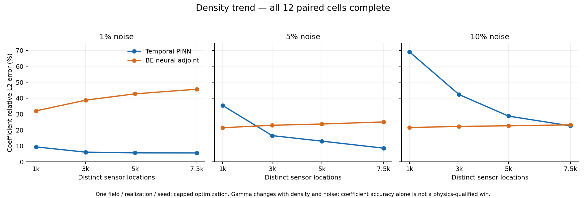
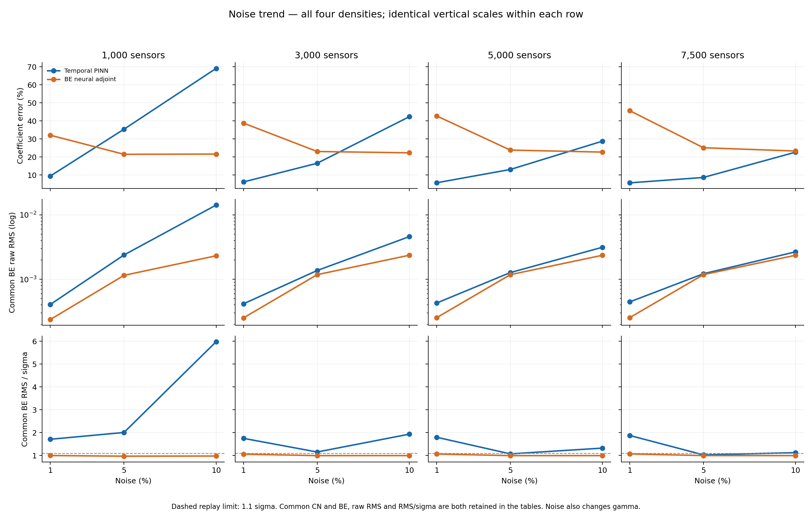

# Completed noise / density sweep

Updated 2026-10-22T08:15:15.973499+00:00. **12/12 paired cells complete; 24 full fits. No active jobs, missing cells or further dispatch.**

This scoped sweep is complete. The broader campaign and its held experiments are separate. All available fits completed 1,000 Adam + 4,000 SSB; every outer round hit its iteration cap. No budget timeouts. Independent supplied-physics, protocol, checkpoint and both common-solver checks preceded coefficient truth scoring. Aggregation only reads validated result tables; no training, solver evaluation or coefficient-truth access.

| Sensors | Noise | PINN coefficient error | BE adjoint error | PINN CN / BE replay (sigma) | Adjoint CN / BE replay (sigma) | PINN qualified advantage |
|---:|---:|---:|---:|---|---|---|
| 1,000 | 1% | 9.40% | 32.04% | 2.9684 / 1.7073 | 2.6065 / 0.9964 | No |
| 3,000 | 1% | 6.12% | 38.76% | 2.7620 / 1.7481 | 2.5813 / 1.0568 | No |
| 5,000 | 1% | 5.66% | 42.75% | 2.8348 / 1.7968 | 2.6098 / 1.0638 | No |
| 7,500 | 1% | 5.61% | 45.64% | 2.9688 / 1.8729 | 2.5951 / 1.0676 | No |
| 1,000 | 5% | 35.37% | 21.45% | 1.9236 / 2.0052 | 1.0760 / 0.9673 | No |
| 3,000 | 5% | 16.48% | 23.01% | 1.1355 / 1.1501 | 1.0949 / 0.9915 | No |
| 5,000 | 5% | 13.03% | 23.79% | 1.1024 / 1.0685 | 1.0979 / 0.9915 | No |
| 7,500 | 5% | 8.62% | 25.09% | 1.0972 / 1.0252 | 1.0984 / 0.9936 | Yes, single case |
| 1,000 | 10% | 69.10% | 21.58% | 5.8598 / 5.9759 | 1.0013 / 0.9741 | No |
| 3,000 | 10% | 42.30% | 22.27% | 1.8579 / 1.9312 | 1.0195 / 0.9934 | No |
| 5,000 | 10% | 28.75% | 22.67% | 1.2753 / 1.3210 | 1.0195 / 0.9922 | No |
| 7,500 | 10% | 22.64% | 23.26% | 1.0982 / 1.1218 | 1.0193 / 0.9925 | No |

Observed findings:

- At 5% noise, increasing density from 1,000 to 7,500 lowers PINN coefficient error from 35.37% to 8.62%; BE adjoint error rises from 21.45% to 25.09%. PINN has lower coefficient error at 3,000, 5,000 and 7,500, but only the 7,500-sensor fit passes both replay screens.
- The new 5,000/5% PINN has 13.03% error versus adjoint 23.79%. PINN BE replay passes (1.068481 sigma), while CN replay narrowly fails (1.102375 > 1.1). At 7,500/5%, PINN CN replay narrowly passes (1.097229). Keep continuous values visible: a narrow fixed-threshold pass/fail difference is not evidence of a robust population boundary.
- At 1% noise, PINN coefficient error improves from 9.40% to 5.61% with density, but all PINNs fail both replays. BE adjoint coefficient error rises from 32.04% to 45.64%; every BE replay passes while CN replay fails. This mismatch does not establish a unique cause, convergence or general method superiority.
- At 10% noise, PINN error falls from 69.10% to 22.64% with density. Adjoint errors are 21.58%–23.26%, and all its replays pass both screens. PINN at 7,500 has slightly lower coefficient error than adjoint but fails BE replay (1.121848), despite passing CN.
- PINN has a consistency-qualified coefficient advantage in 1 of 12 primary cells; adjoint has lower coefficient error with both replay screens passing in 4 cells. Remaining cells have no such qualified advantage. These counts describe this fixed exploratory matrix, not population win rates.

Definition: a consistency-qualified coefficient advantage requires completed fits, lower relative L2 coefficient error against the matched neural method, independent supplied-physics/protocol checks, and both common CN and BE replay <=1.1 sigma. Thresholds, evaluation solvers, checkpoints and seeds were not selected after seeing coefficient truth. Passing implementation checks is distinct from replay consistency; passing the replay screen is not exact PDE satisfaction.

Limits: one smooth field, one common observation/noise realization, one optimizer seed and capped optimization (not proven convergence). Gamma changes with noise/count at fixed alpha. The parent observation-fitted 5%-data warm start is shared. Nested locations sample a fine-grid RK4 forward dataset with a 65-grid inversion; the data were not CN-generated. AD/FD, shifted random pairs/fixed grid and soft/hard state constraints remain different finite objectives. Colab T4/CPU and Kaggle CPU resources differ between cells; no isolated causal density/noise, speed or bitwise trajectory claim. Continuous PDE probes, IC/BC, raw and sigma-normalized CN/BE replays, actual caps/evaluations/resources and statuses are retained in individual case reports and the full CSV. The existing 10,000-sensor reference lies outside this primary matrix and is excluded from the counts/plots.

Legacy v22 aggregation: key, eta and sigma come from its unchanged frozen protocol/metrics; raw RMS is its existing validated normalized replay times sigma. No re-evaluation/refit. Both Colab returns preserve original export manifests/notebooks/attempts, and the duplicated 3,000-sensor result in the second archive was bitwise identical and reused. Earlier partial tables/reports/figures remain retained.

No additional fits are authorized by completion of this report. Held v20/other fields/UI remain held.
