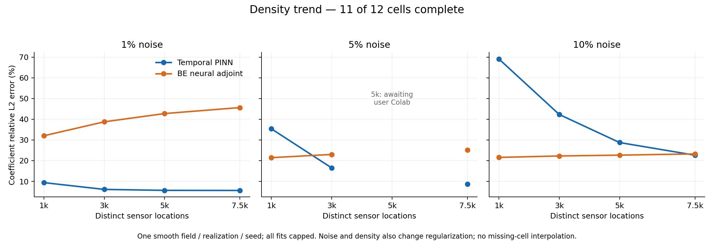
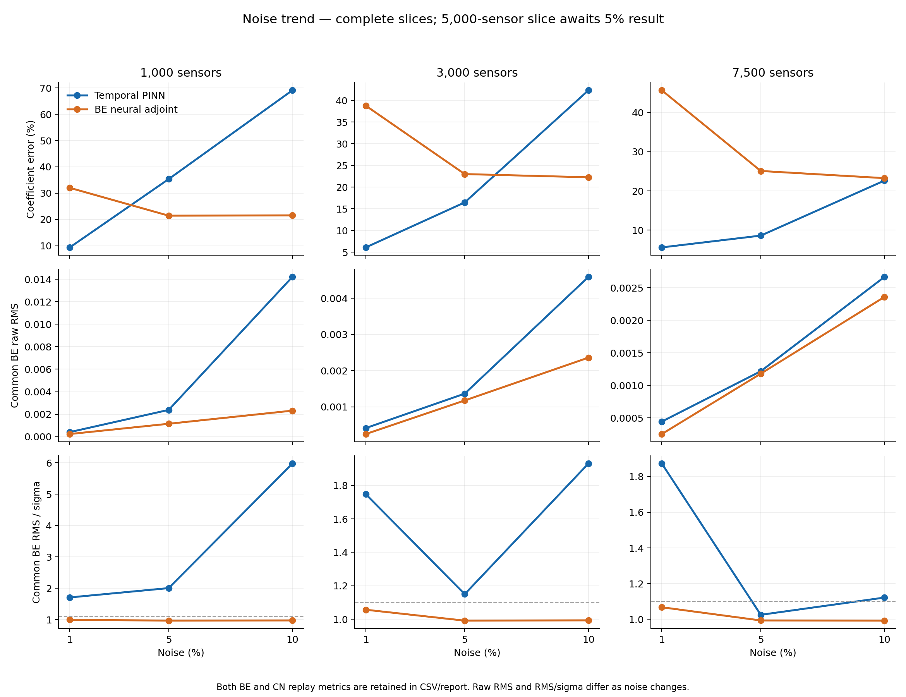

# Noise / density sweep — PARTIAL scientific report

Updated 2026-10-22T08:04:49.244506+00:00. **11/12 paired cells complete, 22 full fits. Missing: user-owned 5,000 sensors / 5% noise. All agent-owned fits complete; no active jobs or further dispatch.**

All available fits completed 1,000 Adam + 4,000 SSB; all 10 rounds capped, no budget timeouts. Source/input/checkpoint/shared-initial/objective/known physics/common BE and CN checks preceded coefficient truth scoring. Aggregation does not refit or select cases/checkpoints/seeds. Legacy v22 CSV lacks eta: assigned its explicitly predeclared 5% protocol for aggregation only, not changed data. First missing-eta aggregation assertion/output retained.

| Sensors | Noise | PINN D error | BE adjoint D error | PINN replay CN / BE (sigma) | Adjoint replay CN / BE (sigma) | PINN qualified advantage |
|---:|---:|---:|---:|---|---|---|
| 1,000 | 1% | 9.40% | 32.04% | 2.968 / 1.707 | 2.607 / 0.996 | No |
| 3,000 | 1% | 6.12% | 38.76% | 2.762 / 1.748 | 2.581 / 1.057 | No |
| 5,000 | 1% | 5.66% | 42.75% | 2.835 / 1.797 | 2.610 / 1.064 | No |
| 7,500 | 1% | 5.61% | 45.64% | 2.969 / 1.873 | 2.595 / 1.068 | No |
| 1,000 | 5% | 35.37% | 21.45% | 1.924 / 2.005 | 1.076 / 0.967 | No |
| 3,000 | 5% | 16.48% | 23.01% | 1.136 / 1.150 | 1.095 / 0.992 | No |
| 5,000 | 5% | Awaited | Awaited | — | — | Missing, not a loss |
| 7,500 | 5% | 8.62% | 25.09% | 1.097 / 1.025 | 1.098 / 0.994 | Yes, single case |
| 1,000 | 10% | 69.10% | 21.58% | 5.860 / 5.976 | 1.001 / 0.974 | No |
| 3,000 | 10% | 42.30% | 22.27% | 1.858 / 1.931 | 1.019 / 0.993 | No |
| 5,000 | 10% | 28.75% | 22.67% | 1.275 / 1.321 | 1.019 / 0.992 | No |
| 7,500 | 10% | 22.64% | 23.26% | 1.098 / 1.122 | 1.019 / 0.993 | No |

Observed findings:

- At 1% noise, PINN coefficient error decreases from 9.40% to 5.61% with density, but every PINN fails both replay screens. BE adjoint coefficient error increases from 32.04% to 45.64%; each BE replay passes while CN fails. This does not establish a unique cause or general method superiority.
- At 5% noise, 7,500 sensors gives a consistency-qualified PINN coefficient advantage: 8.62% vs 25.09%, both methods pass both screens. CN is close to 1.1. At 3,000 sensors PINN has lower coefficient error but fails both screens. The 5,000-sensor cell is pending.
- At 10% noise, PINN coefficient error decreases from 69.10% to 22.64% as density grows. At 7,500 it is slightly below adjoint 23.26%, but BE replay 1.12185 sigma fails 1.1; CN passes. Adjoint passes both at all four densities.
- Small state-network observation error is not a coefficient/replay consistency guarantee. Only one of 11 available primary cells meets the declared PINN coefficient-advantage plus replay-consistency screen. This is not a population win rate.

Limits: one smooth field, one common noise/observation realization and optimizer seed; all optimization capped, not proven converged. Nested fine-grid RK4 data with 65-grid inversion. Gamma changes with noise and count at fixed alpha; shared parent 5%-data warm start and different Colab/Kaggle resources qualify trends. AD/FD, random shifted pairs/fixed grid and soft/hard constraints remain different finite objectives. No isolated causal noise/density or speed claim. Continuous PDE, ICBC, actual evals/resources/statuses and raw/sigma replays remain in case reports/consolidated CSV.

Replay criterion: common CN <=1.1 sigma AND common BE <=1.1 sigma; both reported without outcome-based solver selection. Missing/partial outcomes are not losses. The 10,000-sensor reference is outside this primary matrix and excluded from counts/figures.

Await user 5,000/5% Colab archive; independently validate before truth, then finalize row/plots/report. No additional fit automatically.

Aggregation schema note: legacy v22 key/eta/raw replay columns/sigma were absent. Key and 5% eta are inherited from its frozen protocol. Raw RMS was reconstructed from preserved metrics sigma times existing independently verified normalized replay; no forward model, training or truth scoring rerun. All consolidated raw RMS entries are present. Initial schema guard failures preserved in tool history/first-attempt CSV.
