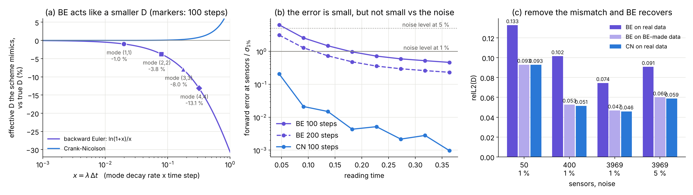

# Why backward Euler damages the inversion although its temperatures look almost right

Follow-up to Study 5. Question: backward Euler (BE) with 100 steps made the classical adjoint's D error 1.4-2x worse than
Crank-Nicolson (CN) with the same 100 steps, yet the two solvers' temperatures look nearly identical. Why?

Script: `be_analysis.py` (from `extended_studies/`: `python run.py study5_time_integrators/be_analysis.py`, about
2.5 minutes). Numbers in `be_analysis.json`, figure `fig_be_mechanism.png`. Field A_smooth, Fo 0.1, 8 reading times;
reference forward = CN with 4,800 steps on the inversion grid (it matches RK4 to four decimals, Study 5).

## The theory

One BE step multiplies a temperature mode of decay rate lambda by 1/(1 + x), with x = lambda dt; the exact factor is
exp(-x). Because 1 + x < exp(x) for every x > 0, **BE always decays too slowly**: its temperatures stay slightly too warm.
Over many steps, (1 + x)^(-n) = exp(-lambda t ln(1+x)/x), so BE behaves like the true equation with D replaced by
D ln(1+x)/x, approximately D (1 - lambda dt / 2). A solver that mimics a smaller D forces the inversion to report a
**larger** D to reproduce the same readings. CN's equivalent error is O(x^2 / 12), negligible here.

The bias depends on the mode: at dt = T/100 the slowest mode (1,1) sees D 1.0 % too small, mode (2,2) 3.8 %, (3,3)
8.0 %, (4,4) 13.1 % (panel a). Finer-scale content is distorted more.

## The tests

**T1. How much do the temperatures change?** (true D, 3,969 sensors x 8 times)

| solver | error in u, % of signal | in units of sigma at 1 % noise | at 5 % | at 10 % | readings too warm |
|---|---|---|---|---|---|
| BE 100 steps | 2.94 % | 2.54 | 0.51 | 0.25 | 72 % |
| BE 200 steps | 1.44 % | 1.25 | 0.25 | 0.12 | 72 % |
| CN 100 steps | 0.085 % | 0.07 | 0.01 | 0.01 | 81 % |
| CN 200 steps | 0.011 % | 0.01 | 0.00 | 0.00 | 79 % |

The 65 x 65 grid itself (vs the RK4 129 x 129 data) contributes only 0.08 sigma. So the intuition "the solver values
barely change" is right for CN (0.085 %) but not for BE at 100 steps: 2.9 % is small in absolute terms, yet 2.5 times
the noise at 1 % noise. BE's error is largest at the first reading (6 sigma), where the faster-decaying modes are still
present (panel b). Halving the step halves the error: first-order behaviour, as expected.

**T2. Why a small temperature error becomes a large D error.** Changing D by 1 % moves u by only 0.81 % of the signal:
temperatures depend weakly on D, so any temperature error is magnified when it is translated back into D. The constant
rescaling of D that makes each solver reproduce the true temperatures:

| solver | D needed | first-order prediction (slowest mode) | leftover after the best rescaling |
|---|---|---|---|
| BE 100 | +2.55 % | +0.99 % | 1.82 sigma |
| BE 200 | +1.25 % | +0.49 % | 0.89 sigma |
| CN 100 | +0.06 % | +0.00 % | 0.06 sigma |

The required shift is 2.6 times the slowest-mode prediction because the readings also contain faster modes, which BE
distorts more. And a uniform shift does not remove the error: 1.82 sigma remains. That remainder is mode-dependent, so
the inversion can only absorb it by inventing spatial structure in D. This is why the D error grows by far more than
2.5 %.

**T3. Direction of the bias in the real inversions** (Study 5, 100 steps). BE's mean recovered D is above CN's in **9 of
9** noise/density cells (median log ratio vs the truth: BE +0.4 to +2.3 %, CN -2.7 to +0.6 %), as the theory predicts.

**T4. The bias also breaks the stopping rule.** The discrepancy principle stops at the first alpha whose misfit reaches
the noise level sigma. When the solver's own error is comparable to sigma, that rule misfires:
- at 400 and 3,969 sensors with 1 % noise, and 3,969 with 5 %, BE can never fit the data to sigma
  (`floor_above_sigma`); CN reaches sigma in all of these except 3,969 / 1 %, where the grid floor is the limit;
- in 4 of the 6 cells where both solvers do reach sigma, BE stops at weaker regularisation (alpha 4-10 against CN's
  12.6-32), because part of its misfit budget is used up by its own error; D then picks up more noise. The other 2 tie.

**T5. Causal test: remove the mismatch.** Data generated by the BE-100 forward itself (true D, the dataset's own noise
draw), then inverted with BE-100:

| sensors, noise | BE on the real (RK4) data | BE on BE-generated data | CN on the real data |
|---|---|---|---|
| 50, 1 % | 0.133 | **0.093** | 0.093 |
| 400, 1 % | 0.102 | **0.053** | 0.051 |
| 3,969, 1 % | 0.074 | **0.047** | 0.046 |
| 3,969, 5 % | 0.091 | **0.060** | 0.059 |

With the mismatch removed, BE inverts as well as CN (within 0.001-0.0013). **BE is not a worse inversion method; the
damage comes entirely from the mismatch between the data and the solver used to explain them.**

## Why density and low noise make it worse

- Noise is random and averages out over many readings; the solver's bias is systematic and does not. With 31,752
  readings, a 2.5-sigma-per-reading bias is overwhelming evidence, and the inversion bends D to explain it.
- Its size relative to the noise sets the damage: 2.5 sigma at 1 % noise, 0.5 sigma at 5 %, 0.25 sigma at 10 %. At 10 %
  noise with 50 sensors the bias is buried in noise and BE is not worse at all (0.160 vs CN 0.175).

## What it means for the project

The earlier "PINN wins at high sensor density" (Study 4) compared the PINN against a BE-100 baseline. That baseline was
fitting a solver error of about 2.5 sigma, exactly in the regime (dense, low-noise) where such a bias hurts most. With CN
the classical method's advantage returns (Study 5). More generally: **a classical inversion is only as good as its forward
solver's error relative to the noise**. Keep the time-stepping error well below sigma -- CN at 100 steps (0.07 sigma) is
enough here. Being first order, BE would need about 250 steps for its average error to fall below sigma at 1 % noise,
and about 600 for the earliest reading.
